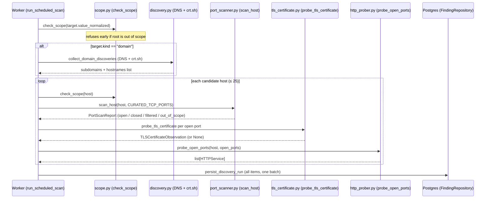

# ASM Scanner

**Audience:** someone joining in week 6 who was not in the week-4 huddles.
**Scope:** how the scanner works and how to run it — the _what_, not the _why_.
Architecture rationale is in [ADR-0004](./adr/0004-finding-taxonomy.md);
pipeline lifecycle and job framework are in [pipeline.md](./pipeline.md).

---

## 1. Stage diagram

One call to `POST /api/v1/targets/{id}/scans` produces one `ScanRun` and one
persistence batch. The worker runs every stage in order inside a single arq job:



**What each stage produces:**

| Stage | Finding kind(s) | Key output |
|---|---|---|
| DNS + crt.sh | `subdomain` | Hostnames to scan in subsequent stages |
| TCP port scan | `open_port` | `host:port/tcp` for every port that completed a handshake |
| TLS certificate | `tls_certificate` | Certificate details; DNS SANs feed back into subdomain findings |
| HTTP prober | `http_service` | `scheme://host:port`, status code, title, headers, technologies |

Stage failures degrade, they do not abort. A TLS parse error on one host
does not lose the port findings for that host or any other
(`DECISIONS.md` §5, `scan.py` lines 183–199).
The `ScanRun.sources_degraded` field records which stages were affected;
see [pipeline.md §6](./pipeline.md) for how to diagnose a stuck run.

---

## 2. The four finding kinds

All four use the same fingerprint rule and upsert logic. See
[ADR-0004](./adr/0004-finding-taxonomy.md) §2 for the full specification.
The short version:

| Kind | Identity (what makes it unique) | `value` format | What lives in `details` |
|---|---|---|---|
| `subdomain` | `(target_id, hostname)` | `admin.example.com` | — (identity is the whole value) |
| `open_port` | `(target_id, host, port, protocol)` | `host:8443/tcp` | `port`, `protocol` |
| `tls_certificate` | `(target_id, host, port)` | `host:8443` | subject, issuer, SANs, validity dates, SHA-256 fingerprint |
| `http_service` | `(target_id, host, port, scheme)` | `https://host:8443` | status code, title, retained headers, cookie names, technologies |

**What makes each one unique** — the points worth remembering:

- `open_port` includes `protocol` — TCP/53 and UDP/53 are different services.
  The scanner only speaks TCP today, so all open-port values end in `/tcp`.
- `tls_certificate` identity is the _endpoint_ (`host:port`), not the
  certificate hash. A certificate renewal changes `details`, not the fingerprint —
  so it registers as a `mutated` finding rather than a resolve-and-recreate.
  Rationale: [ADR-0004 §2](./adr/0004-finding-taxonomy.md).
- `http_service` identity includes `scheme` — an HTTP service and an HTTPS
  service on the same port are two findings.
- `subdomain` identity is the hostname, normalized (lowercase, no trailing dot,
  IDNA, `*.` wildcards stripped). DNS and crt.sh finding the same name is one
  finding; which source found it is provenance recorded in `details`, not identity.

---

## 3. Configuration knobs

All knobs live in `src/app/core/config.py` and are set via environment variables
(`.env` / `compose.yaml`).

| Env var | Default | What it does | Effect of turning it up |
|---|---|---|---|
| `PORT_SCAN_CONCURRENCY` | `50` | Maximum simultaneous TCP connect attempts per `scan_host` call (asyncio semaphore) | Scans faster; more simultaneous open sockets; too high on a restricted kernel may exhaust ephemeral ports or trigger rate-limit counters faster |
| `PORT_SCAN_CONNECT_TIMEOUT_SECONDS` | `1.5` | Per-port TCP connect timeout in seconds | More time before a filtered port is classified; adds linearly to worst-case scan duration; useful on high-latency or firewalled targets |
| `SCAN_SCOPE_ALLOWLIST` | `""` (empty = deny all) | Comma-separated entries controlling which hosts the scanner may reach — see [scanning-policy.md](./scanning-policy.md) | Adding entries expands what the scanner is permitted to connect to; the policy page must be consulted before changing this |
| `SCAN_RATE_LIMIT_DEFAULT_PER_SECOND` | `5` | Rolling one-second admission budget shared by all workers via Redis (sliding window Lua script) | More throughput; a value too large defeats the politeness budget — see [scanning-policy.md](./scanning-policy.md) |
| `SCAN_RATE_LIMIT_OVERRIDES` | `{}` | JSON object keyed by `host` or `operation:host`, e.g. `{"crt.sh": 1}` | Per-host exceptions to the default; useful for well-known slow or sensitive endpoints |
| `SCAN_RATE_LIMIT_MAX_WAIT_SECONDS` | `10.0` | How long a worker will wait for a rate-limit slot before aborting with `RateLimitWaitCapped` | Larger values make a scan tolerant of a congested limiter but can stall a job near its 300 s deadline |

The port list itself is not a knob: `CURATED_TCP_PORTS` is defined as a
compile-time constant in `src/app/modules/asm/scanner/ports.py`
(92 ports across seven categories: remote access, mail, name/directory, web,
file/RPC, databases, messaging/infra, misc). Changing it requires a code
change and a review — that is intentional.

---

## 4. Change detection and how to read it

`GET /api/v1/scan_runs/{id}/changes` returns run-to-run finding differences.
See [pipeline.md §8](./pipeline.md) for the full contract.

The fields that matter here:

- **`new`** — fingerprint not seen before this run.
- **`reappeared`** — fingerprint was `resolved`, seen again.
- **`resolved`** — finding not observed in this run, for a kind this stage is
  authoritative for. A `tls_certificate` run cannot resolve `subdomain` findings.
- **`unchanged`** — observed again, `details` identical.
- **`mutated`** — observed again, `details` differ (e.g. server version bump,
  certificate renewal).

If a source is degraded, absent findings in that source's kinds are **not**
resolved. An incomplete run is not evidence that an asset disappeared —
`sources_degraded` tells you which kinds to discount.

---

## 5. Running a scan against the lab from a clean clone

These commands work top to bottom. They require Docker, `just`, and OpenSSL
on the host; no other tools.

```bash
# 1. Clone and configure
git clone git@github.com:emad-anwer/tem-platform.git
cd tem-platform
cp .env.example .env          # already has the lab allowlist pre-filled

# 2. Start the stack (app, postgres, redis, worker)
just up
just migrate                  # run Alembic migrations

# 3. Start the four lab scan targets (generates TLS certs if missing)
just lab-up

# 4. Create a tenant and get a bearer token
#    (follow docs/auth.md to bootstrap Zitadel and obtain TOKEN)

# 5. Create a hostname target (lab-nginx runs on the compose network as "lab-nginx")
curl -s -X POST http://localhost:8000/api/v1/targets \
     -H "Authorization: Bearer $TOKEN" \
     -H "Content-Type: application/json" \
     -d '{"kind": "hostname", "value": "lab-nginx"}' | python3 -m json.tool

# Save the returned target id
TARGET_ID=<id from response>

# 6. Start a scan
curl -s -X POST "http://localhost:8000/api/v1/targets/$TARGET_ID/scans" \
     -H "Authorization: Bearer $TOKEN" | python3 -m json.tool

# Save the returned run id
RUN_ID=<id from response>

# 7. Poll until status == "succeeded" (usually < 5 s)
curl -s "http://localhost:8000/api/v1/scan_runs/$RUN_ID" \
     -H "Authorization: Bearer $TOKEN" | python3 -m json.tool

# 8. Read the findings
curl -s "http://localhost:8000/api/v1/findings?target_id=$TARGET_ID&scan_run_id=$RUN_ID" \
     -H "Authorization: Bearer $TOKEN" | python3 -m json.tool

# 9. (Optional) Read change detection
curl -s "http://localhost:8000/api/v1/scan_runs/$RUN_ID/changes" \
     -H "Authorization: Bearer $TOKEN" | python3 -m json.tool
```

Expected findings for `lab-nginx` after a successful run:

| `kind` | `value` |
|---|---|
| `open_port` | `lab-nginx:80/tcp` |
| `http_service` | `http://lab-nginx:80` |

For expected findings for all four lab targets and their ground-truth banners,
SANs, and technology fingerprints, see **[docs/target-lab.md](./target-lab.md)**.
That table is the authoritative source; do not copy it here.

**Worker logs** follow the job via `just worker-logs`; filter to a single run:

```bash
docker compose logs worker --no-log-prefix --since 10m 2>/dev/null \
  | jq -R 'fromjson? | select(.job_id == "<RUN_ID>")'
```

**Run the automated lab tests** (inside the compose network, lab must be up):

```bash
just test-unit            # unit tests only, no lab needed
just test                 # all tests including e2e (requires just lab-up)
```
