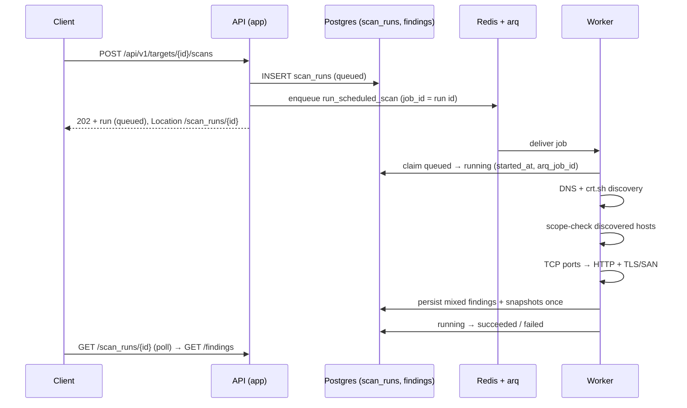

# Pipeline: targets → jobs → findings

**Audience:** a week-5 engineer adding a threat-intel job who was not in the week-3 huddle.
**Scope:** this is a how-to guide (Diátaxis sense: task-oriented, for someone debugging at work),
not a tutorial. Reference contracts live in
[ADR-0003](./adr/0003-pipeline-contract.md); the 30-second lifecycle summary in
[job-lifecycle](./job-lifecycle.md); log format in [logging](./logging.md).

## 1. The path from `POST /targets/{id}/scans` to a persisted finding

One paragraph: the API does no scanning. `POST /api/v1/targets/{id}/scans`
(`src/app/core/pipeline/service.py::start_scan`) creates a `scan_runs` row in
`queued`, enqueues `run_scheduled_scan` on Redis via arq
(`_job_id=str(scan_run.id)`), and returns `202` + `Location: /api/v1/scan_runs/{id}`.
The `worker` service (same image as `app`, no ports, `compose.yaml`) picks the job up,
`@tenant_job` rebuilds tenant scope from the payload, `execute_scan_run`
claims the row `queued → running`, then runs DNS/crt.sh, TCP ports, HTTP, and TLS/SAN
stages in one job. Each stage contributes to one finding batch and one changes snapshot
set before the row becomes `succeeded` or `failed`. Stage failures are recorded in
`sources_degraded`/`error_message`; successful stages still persist. Postgres is the source of truth;
Redis/arq is delivery only. Poll `GET /api/v1/scan_runs/{id}`; read results at
`GET /api/v1/findings?target_id=…&scan_run_id=…`.

One job is the right boundary while the bounded host count and scanner timeouts fit within
`job_timeout` (300 seconds): retries reuse the same run and one final persistence call creates a
coherent changes snapshot. Revisit a multi-job/saga design if scans routinely approach that
deadline or stages need independent retries; child jobs must still write to the parent run id.



**Scan scope (W4-02), defense in depth.** Three layers refuse, and the
**connection layer is the foundation**: scanner traffic only leaves through
`scoped_open_connection()` (TCP, the seam W4-04 connects through) or
`scoped_http_client()` (HTTP, W4-06's) in `src/app/core/scope.py`. Both
decide *at the moment the connection is about to open* — nothing above them
can forget to ask — and both connect to the **checked** address instead of
resolving again, which is the DNS-rebinding answer. Above that, the worker
re-checks the root before collection and re-checks every discovered host before
port scanning (`scan.py::orchestrate_scan_run`), and the API's `start_scan` answers
`403` problem details before a run row exists — nothing enqueued. Refusals
log `scan.scope_refused` (`target`, `resolved`, `reason`); inside a job they
are **terminal** failures carrying `terminal: target outside scan scope (…)`.
Loopback is reachable only through a `host:port` entry; link-local and
multicast are blocked even when listed. Full scope policy: W4-11.

## 2. How a module adds a new job

Do these four things; the framework does the rest. The shared ASM entry point is
`src/app/core/jobs/scan.py::run_scheduled_scan`; add scanners as collectors there
or in their owning module, and keep the one-run persistence boundary intact.

1. **Payload with `tenant_id`.** A frozen dataclass carrying `tenant_id: UUID`
   plus whatever the job needs (e.g. `run_id`). No token, no headers —
   there is no request inside a job.
2. **Register with `@tenant_job`.** Decorating the coroutine
   (`src/app/core/auth/job_context.py`) validates the payload has a UUID
   `tenant_id`, builds a synthetic
   `Principal(user_id="system:<job>:<job_id>", tenant_id=…, role=SYSTEM)`,
   binds `tenant_id` + `job_id` + `job_name` to every structlog line, registers
   the function in `JOB_REGISTRY` (which is what `WorkerSettings.functions`
   serves), and **resets both contexts in a `finally`** so one event loop
   never leaks tenant A into tenant B's job.
3. **Own your transitions via `execute_scan_run`.** Wrap the work function in
   `execute_scan_run(ctx, work)` (`src/app/core/jobs/lifecycle.py`): it claims
   `queued → running`, applies the 300 s job deadline, classifies failures
   (retryable vs terminal), records retries *without* leaving `running`,
   and finishes `running → succeeded/failed`. Never assign `run.status`
   directly — `ScanRunRepository` refuses status writes outside these methods.
4. **Stay async and bounded.** One blocking call stalls all 10 worker slots.
   Use `asyncio` + `outbound_http_timeout()` (connect 5 s / read 15 s / total 30 s),
   a `Semaphore` for fan-out, per-call timeouts, and result caps.

The framework gives you: enqueue/delivery/retries (arq, `max_tries=3`,
full-jitter backoff), tenant isolation (context + `TenantScopedRepository`),
scrubbed failure rows (≤2000 chars, no secrets/tracebacks/SQL), and
`job_id`/`tenant_id` on every log line. API and recurring-scan cron jobs enqueue the
same registered entry point; there is no separate scheduled-scan stub.

## 3. `ScanRun` states

Four states, three legal moves (`src/app/core/jobs/states.py`):

```
queued → running → succeeded
                 → failed
```

| State | Means | Who writes it |
|---|---|---|
| `queued` | Row created by the API, waiting in Redis | `PipelineService.start_scan` |
| `running` | Worker claimed it (`started_at`, `arq_job_id` set) | `claim_for_job` |
| `succeeded` | Work finished, counts written | `succeed` |
| `failed` | Terminal, with `error_kind` + scrubbed `error_message` | `fail` / `fail_stale` |

Transitions nobody enqueues: there is no `running → queued`, no retry that
creates a second row (retries reuse the row and bump `attempt`), and no
resurrection — `claim_for_job` and `_finish` return the row unchanged if it is
already `succeeded`/`failed`, so a redelivered job is a no-op. Between retries
the row stays `running` with `error_kind=retryable` so polling clients can tell
"waiting before retry N" apart from "actively executing". `error_kind` is
`retryable`, `terminal`, or `stale` (see §6).

## 4. Finding fingerprints: duplicates and `first_seen_at`

Rule (ADR-0003 §6, implemented in
`src/app/core/discovery.py::_fingerprint` +
`FindingRepository.upsert_discovery`):

```
fingerprint = hex(sha256(kind + "|" + str(target.id) + "|" + value_normalized))
```

Today `kind` is always `subdomain` and normalization is lowercase, strip
trailing dot, drop `*.` wildcards, IDNA/punycode, keep only names in the target
domain. `str(target.id)` must be the hyphenated UUID string — the `.hex` form
(no hyphens) hashes differently and silently breaks dedup across processes.

What it means: DNS and crt.sh finding `admin.example.com` is **one** finding
(source is deliberately excluded). Rescanning never duplicates: Postgres
`ON CONFLICT (tenant_id, fingerprint) DO UPDATE` bumps `last_seen_at`,
`last_seen_run_id`, `times_seen + 1`, reopens `status` to `active` — and never
touches `first_seen_at`. That column is set once at insert and pinned by the
upsert plus a regression test, so `first_seen_at` answers "when did we first
see this threat" while `last_seen_at`/`times_seen` answer "is it still there".
Findings absent from a rescan are marked `resolved`, never deleted — a vanished
subdomain is a signal.

## 5. How to read worker logs

Logs are JSON (structlog, `src/app/core/logging.py`); every job line carries
`job_id`, `tenant_id`, `job_name`. `job_id` is the scan-run id
(enqueued as `_job_id=str(scan_run.id)`), so start from the run:

```bash
# live tail
just worker-logs

# one job's lines from the last 30 minutes (run id == job id)
docker compose logs worker --no-log-prefix --since 30m 2>/dev/null \
  | jq -R 'fromjson? | select(.job_id == "<scan-run-uuid>")'

# same, but all lines for one tenant
docker compose logs worker --no-log-prefix --since 30m 2>/dev/null \
  | jq -R 'fromjson? | select(.tenant_id == "<tenant-uuid>")'

# quick non-jq fallback
docker compose logs worker --since 30m | grep "<scan-run-uuid>"
```

Correlate with the row: `GET /api/v1/scan_runs/<id>` gives `status`,
`attempt`/`max_attempts`, `arq_job_id`, `sources_attempted`/`sources_degraded`,
counts, and the scrubbed `error_kind`/`error_message`. Secrets never appear in
either place — if you need the real exception, reproduce it locally, it is not
in the logs by design.

## 6. A scan is stuck in `running` — in this order

1. **Read the row.** `GET /api/v1/scan_runs/<id>` — note `status`, `started_at`,
   `attempt`, `arq_job_id`, `sources_degraded`.
2. **Apply the age rule.** `job_timeout` is 300 s (`src/app/worker/settings.py`).
   `running` older than **2 × timeout (10 minutes)** is suspect, not busy:
   `mark_stale_runs` / `fail_stale` exists to mark exactly these
   `failed`/`stale`. No heartbeat thread in week 3 — age is the detector
   (ADR-0003 §3).
3. **Is the worker alive?** `docker compose ps worker` and
   `docker compose logs worker --since 10m | tail -50`. Worker down →
   the row sits in `running` with nobody working; restart with `just worker`
   (a queue consumer that tolerates a missing queue reports healthy while doing
   nothing, so the worker crash-loops on missing Redis at startup — by design).
   API healthy + worker dead is a normal split: the two processes fail
   independently.
4. **Find the job's lines** (§5) using the `arq_job_id` from the row. No lines
   at all → the job never started (Redis/enqueue path). Lines ending mid-run →
   the worker was SIGKILLed or hit Docker's stop timeout (`stop_grace_period`
   is 300 s to let in-flight jobs drain).
5. **Check `sources_degraded` before calling it a bug.** `["crtsh"]` with zero
   findings means "source was down", not "nothing exists" (§7).

## 7. When crt.sh is down

By design a down source returns **fewer results, never an exception**
(`DECISIONS.md` §5, ADR-0003 §7): `CertificateTransparencySource.collect`
catches `httpx.HTTPError`/bad JSON and returns `degraded=True`, which lands in
`scan_runs.sources_degraded` with a note. Confirm it is crt.sh and not your code:

```bash
# 1. the row says so: sources_degraded contains "crtsh", error_message notes it
curl -s http://localhost:8000/api/v1/scan_runs/<id> -H "Authorization: Bearer $TOKEN" | python3 -m json.tool

# 2. ask crt.sh directly (same query the worker sends)
curl -s -m 30 "https://crt.sh/?q=%25.example.com&output=json" | head -c 300; echo

# 3. rule out the worker: DNS-only path still produced findings, worker logs show
#    "crt.sh unavailable" with your job_id (§5)
```

If step 1 names `crtsh`, step 2 fails the same way from your laptop, and step 3
shows DNS results landing, it is an upstream outage — the scan correctly
degraded. Do not "fix" it by retrying the whole scan in a loop; wait and rescan.
If step 2 succeeds but the row still says degraded, it is our bug — look at the
worker's outbound timeouts and the `respx` fixtures in `tests/test_discovery.py`
(502 + timeout cases) to reproduce it offline.

## 8. Run-to-run finding changes

Read `GET /api/v1/scan_runs/{id}/changes` after a run succeeds. The response
contains total counts for `new`, `reappeared`, `resolved`, `unchanged`, and
`mutated`, plus one cursor-paginated page of finding resources grouped into
those buckets. `size` and `cursor` use the same created-at/id cursor contract as
the other pipeline collections. The baseline is the target's most recent
successful run; failed runs are ignored.

`scan_run_findings` stores an immutable finding snapshot and its classification
for each run. The `findings` row remains the current state: `first_seen_at` is
never reset, `last_seen_at` and `times_seen` advance on re-observation, and a
resolved finding is retained so it can later be classified as `reappeared`.
`ScanRun.findings_count` and `new_findings_count` remain the persisted run
counters; the other bucket counts are derived from the run snapshots.

If any source for a run is degraded, findings absent from that run are not
resolved. Active findings in the kinds that run produces are carried into its
snapshot as `unchanged`, because an incomplete source result is not evidence
that an asset disappeared. Resolution is scoped to the kinds the scanner
produces, so a port-only run cannot resolve subdomain findings.

This GET route has no separate read permission in
`src/app/core/auth/permissions.py`; every authenticated role can read within
its tenant, matching the current pipeline GET routes. Revisit this before
week-6 alerts introduce more sensitive read surfaces.
