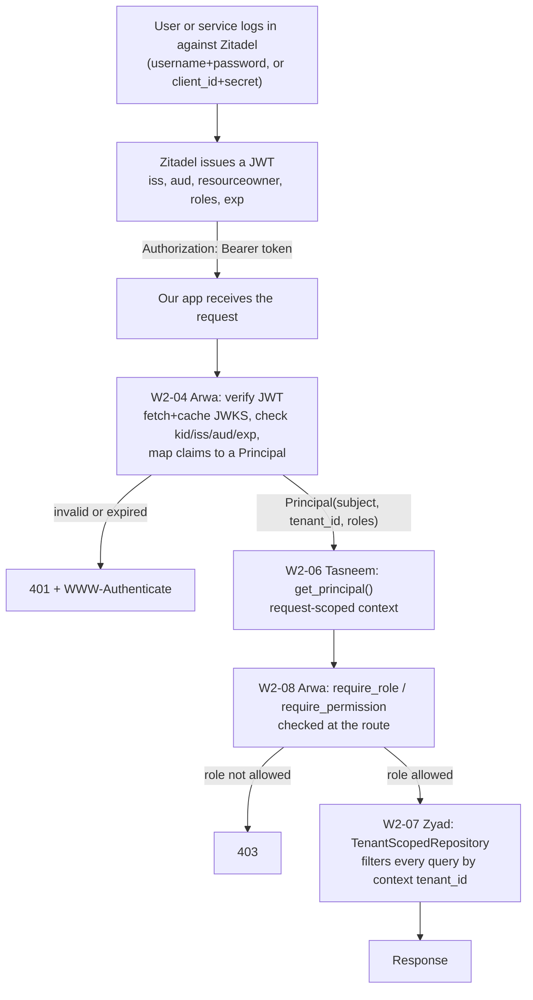
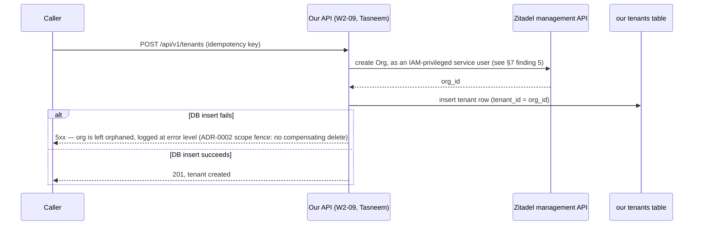

# Zitadel Local Identity Provider — Setup & Findings

**Status:** Active · **Module:** Identity Infra Prework (W2-05) · **Author:** Mentor (infra/docs only, no application code)

This is the base Zitadel Compose service and console walkthrough for **W2-05**. It gets you
from `git clone` to holding a real, decoded access token that satisfies ADR-0002. It does
**not** include the idempotent bootstrap script or `just zitadel-bootstrap` recipe — that
automation is the actual W2-05 deliverable and is intentionally left for you to build. What's
here is meant to make that task an ordinary one instead of a science project: the compose
service works, the console steps are spelled out, and every trap we hit while proving it out is
documented below so you don't lose a day rediscovering them.

Read [ADR-0002](./adr/0002-identity-and-tenant-isolation.md) first if you haven't. Everything
here exists to satisfy it.

---

## 0. What is Zitadel, and why are we doing any of this?

If you've never touched an identity provider (IdP) before, here's the shape of the whole system
before you dive into steps — skip this section if you already know OIDC/JWT.

**The problem:** our app needs to know *who* is calling it and *what tenant/role* they belong to,
without trusting the caller to just tell us ("I'm the admin of tenant X, promise"). The standard
way to solve this is to hand that job to a dedicated identity provider — Zitadel, in our case,
instead of Auth0/Okta/Cognito — that handles login, issues a cryptographically signed token, and
lets our app verify that token without ever talking to Zitadel again per-request.

**The flow, end to end:**

1. A user logs in **against Zitadel** (username/password, not our app) — either through Zitadel's
   own login pages, or via a machine-to-machine client secret for service accounts.
2. Zitadel hands back an **access token** — a JWT (JSON Web Token), which is just a signed blob of
   claims (facts) about who logged in: their user ID, their tenant, their role, when it expires.
3. The caller sends that JWT to **our app** (`Authorization: Bearer <token>`).
4. Our app verifies the JWT's signature using Zitadel's public keys (the **JWKS**, fetched once
   and cached — this is W2-04's job, not this doc's), then reads the claims out of it to decide
   *who this is* and *what they're allowed to do* (W2-06/07/08's job).

Same thing, as a picture, with which issue owns each box (this PR only builds the Zitadel box —
everything after "Our app receives request" is other people's Week 2 work, not built here):



**Why this doc exists:** step 1 and 2 need a running Zitadel with a project/roles/app configured
before anyone can even get a token to test steps 3–4 against. This doc gets you a working Zitadel
and a real token in hand. It does **not** build the "our app checks the token" half — that's
already split across other W2 issues (see the intro above).

**A few terms you'll see everywhere below, in plain language:**

| Term | Means, in this context |
|---|---|
| **OIDC** | The overall protocol (OpenID Connect) Zitadel speaks for login + tokens. Think "the rulebook." |
| **JWT** | The token format: three base64 chunks (`header.payload.signature`) — readable without a password, but tamper-proof because of the signature. The opposite is an **opaque token**, a random string you can't read at all, meaningless without asking the IdP "what is this?" |
| **Claim** | One fact inside the JWT payload, e.g. `"iss": "http://zitadel:8080"`. ADR-0002 requires specific claims to be present — see the checklist in §4. |
| **Issuer (`iss`)** | Which Zitadel instance/URL issued this token. Our app checks this matches what it expects, or it rejects the token outright. |
| **Audience (`aud`)** | Which app(s) this token is valid for. Prevents a token meant for App A being replayed against App B. |
| **JWKS** | "JSON Web Key Set" — Zitadel's *public* signing keys, published at a URL, used to verify a JWT's signature without ever contacting Zitadel per-request. |
| **`kid`** | "Key ID" — tells you *which* key in the JWKS was used to sign this particular token (Zitadel rotates keys over time). |
| **Scope** | What you're asking the IdP for permission to see, requested during login (e.g. `openid`, or the role-claim scope in §4). Ask for the wrong/missing scope and the claim you wanted just won't show up — not an error, just silently absent. |
| **PKCE** | A security add-on to the login flow (used by "public" clients like browser/mobile apps that can't safely hold a secret). You'll see `code_challenge`/`code_verifier` params because of it — you don't need to understand the cryptography, just that both values must match between the start and end of the flow. |
| **Project / Role / Application** | Zitadel's own vocabulary — see the intro of §3 for what each one means before you start clicking. |
| **Organization (Org)** | Zitadel's tenant boundary. Per ADR-0002 this is a **1:1 mapping**: one Org = one tenant in our system. See the callout below — this is easy to conflate with "Project" but they are not the same thing. |

**How this maps to *our* tenants specifically:** the Project/Roles/Application you set up in §3
is **platform-wide, one-time setup** — there is exactly one of each, shared by every tenant.
Tenants map to **Organizations** instead: per ADR-0002, one Zitadel Org = one tenant, always 1:1.
The Org the bootstrap admin lands in at first boot (`ZITADEL_FIRSTINSTANCE_ORG_*`) is just
"tenant zero" for local testing — nothing about it is structurally special. When W2-09
(tenant provisioning) creates a *new* tenant later, that means creating a *new Org* via the
Management API (`POST /orgs`) and granting its users roles against the **same** shared project —
never a new project, never a new application. At login, the
`urn:zitadel:iam:user:resourceowner:id` claim in a user's JWT is literally their **Org ID** —
that's the only place `tenant_id` is allowed to come from, per ADR-0002 (never a URL/header/query
param). So: **Org = tenant, Project = the platform, one shared thing every tenant's users get
granted roles against.**

---

## 1. Quickstart

```bash
git clone <repo> && cd tem-platform
cp .env.example .env          # fill in ZITADEL_PROJECT_ID after step 3 below
just up
```

Cold start (`docker compose down -v && up -d`, empty volumes) reaches a healthy `zitadel`
container in **~20–30 seconds** on a laptop. `zitadel-db` and `zitadel` add roughly **~200 MB**
of RAM to the stack at idle (~60 MB for zitadel-db, ~150 MB for zitadel) — noticeable but not
heavy. First boot also runs Zitadel's internal setup/migration steps once; you'll see
`migration failed` in the logs if something is wrong with the bootstrap env vars (see §6).

Console at **http://localhost:8080/ui/console** (or `http://zitadel:8080/ui/console` — see the
issuer trap immediately below before either URL confuses you). Log in with
`ZITADEL_ADMIN_USERNAME` / `ZITADEL_ADMIN_PASSWORD` from your `.env`.

---

## 2. The issuer trap — read this before anything else

`ZITADEL_EXTERNALDOMAIN` in `compose.yaml` is set to `zitadel` — the Compose service name —
**not** `localhost`. Every token's `iss` claim, and Zitadel's own instance routing, is keyed off
this value. This is deliberate: a container on the Compose network (the `app` service, later
consuming JWKS in W2-04) and a browser/script on your host must see the **same** issuer, or
token validation will disagree with itself depending on who's asking.

**The consequence:** Zitadel resolves which virtual instance to serve based on the `Host` header
of the incoming request. A request to `http://localhost:8080/...` gets:

```
unable to set instance using origin &{localhost:8080  http} (ExternalDomain is zitadel): ID=QUERY-1kIjX Message=Instance not found.
```

(`404`). This is not a bug — it's Zitadel correctly refusing a domain it doesn't recognize. Two
endpoints are exempt because they don't need instance resolution: `/debug/healthz` and
`/debug/ready` (which is what `compose.yaml`'s healthcheck and `just health` use) — those work
fine on `localhost:8080`. Everything else (`/.well-known/openid-configuration`, `/oauth/v2/*`,
the console UI, `/ui/login/*`) needs the `Host: zitadel` match.

**Fix, one time, on your host:**

**macOS / Linux** — add the line to `/etc/hosts`:

```bash
echo "127.0.0.1 zitadel" | sudo tee -a /etc/hosts
```

**Windows** — the hosts file is `C:\Windows\System32\drivers\etc\hosts`, and editing it needs an
elevated (Run as Administrator) prompt. Either of these, from an **Administrator** PowerShell:

```powershell
Add-Content -Path C:\Windows\System32\drivers\etc\hosts -Value "127.0.0.1 zitadel"
```

or, from an **Administrator** Command Prompt:

```cmd
echo 127.0.0.1 zitadel >> C:\Windows\System32\drivers\etc\hosts
```

(A regular, non-elevated prompt will fail silently or with "Access is denied" — right-click
PowerShell/cmd and choose "Run as administrator" first. If you're on WSL2, edit the Windows hosts
file above, not the one inside the WSL Linux filesystem — Docker Desktop's ports are reachable
from the Windows side, which is what your browser uses.)

After that, `http://zitadel:8080/...` works from your host exactly like it works from inside
any container on the Compose network (Docker's embedded DNS already resolves `zitadel` there —
no `/etc/hosts` edit needed *inside* containers, only on the host). Everything in this doc and
in the `just zitadel-*` recipes assumes this entry exists. **Once it's there, always use
`http://zitadel:8080/...` — never `http://localhost:8080/...` or the raw `127.0.0.1:8080`, both
of which will 404 with `Instance not found` regardless of the hosts entry, since Zitadel checks
the `Host` header of the request, not which IP it resolved to.**

If you'd rather not touch `/etc/hosts`, `curl --resolve zitadel:8080:127.0.0.1 ...` does the
same thing for a single command and is how this doc's evidence was generated.

---

## 3. Console steps: project, roles, app

Zitadel needs a **project** with the three ADR-0002 roles and at least one **application**
before any client can get a usable token. These are the manual steps (there is no automation
for this yet — that's your W2-05 task).

**The mental model, before you click anything:** a **project** is just our app's namespace
inside Zitadel — the container everything else below lives in. A **role** is a named permission
bucket (`owner`/`analyst`/`viewer`) that starts out meaning nothing; it only becomes real once you
(a) turn on the "put roles in the token" switches (steps 4 and 5 below) and (b) actually **grant**
a specific role to a specific user (step 6) — skipping either one means the roles claim shows up
empty, with no error to tell you why. An **application** is a registered "thing allowed to ask
Zitadel for a token" — a browser app, a native app, a service account, etc. — each with its own
client ID and its own settings for *how* it's allowed to log in and *what* its tokens look like.
Do the steps in order; later steps assume the project/roles from earlier ones already exist.

1. Log into the console as the bootstrap admin.
2. **Projects → New Project.** Name it (e.g. `tem-platform`). Note the **Project ID** shown on
   the project's General tab — this is `ZITADEL_PROJECT_ID` in `.env`.
3. **Project → Roles → New.** Add exactly three role keys: `owner`, `analyst`, `viewer`
   (Display Name can match). These must match ADR-0002 exactly — the auth layer will read these
   literal strings out of the token.
4. **Project → General → enable "Assert Roles on Authentication"** (this is
   `project_role_assertion` under the hood) — without it, roles you grant a user will **not**
   appear in their token even if everything else is configured correctly.
5. **Project → Applications → New.**
   - Type: pick based on what's consuming the token. For a browser/native OIDC login test,
     choose **Native**, redirect URI `http://localhost:<some-port>/callback` (must start with
     `http://localhost`, `http://127.0.0.1`, or `http://[::1]` — anything else is accepted but
     flagged non-compliant).
   - Authentication Method: **None** (PKCE, public client) for a native/test app.
   - **Token Type: JWT**, not opaque — this is the ADR-0002-required setting and is **not** the
     default (see §7).
   - Enable **"Add user roles to the access token"** and **"...to the ID token"** — these are
     `access_token_role_assertion` / `id_token_role_assertion`. Same trap as step 4: without
     this on the *application*, roles don't appear even if the project-level assertion is on.
   - Save. Note the **Client ID**.
6. **Grant yourself (or a test user) the roles:** Project → Authorizations (or the user's
   Authorizations tab) → **New Authorization** → pick the project → select all three roles.
   Without this grant, the roles claim is simply empty, assertion settings notwithstanding.
7. For a machine-to-machine client instead of a human login, use **Users → Service Users → New**
   instead of step 5. See §7 for a hard limitation this path has.

This walkthrough was verified end-to-end via Zitadel's Management API (`/management/v1/...`)
rather than literal console clicks, since this environment has no browser available — but it's
the same operations the console UI performs, and the console's field names above (assertion
toggles, token type, role keys) match the actual API fields we drove
(`project_role_assertion`, `access_token_role_assertion`, `access_token_type`). Screenshots
would need a human with a browser to confirm pixel-for-pixel, but the underlying mechanics are
confirmed working.

---

## 4. Getting and checking a token

**Human login (recommended path to test against):** run the OIDC Authorization Code + PKCE flow
against the application from §3 step 5. If you have a browser, this is just visiting
`http://zitadel:8080/oauth/v2/authorize?client_id=...&redirect_uri=...&response_type=code&scope=openid%20profile%20urn:zitadel:iam:org:project:id:{PROJECT_ID}:aud%20urn:zitadel:iam:user:resourceowner%20urn:zitadel:iam:org:project:roles&code_challenge=...&code_challenge_method=S256`
and logging in normally; the redirect will carry `?code=...`. Exchange it:

```bash
just zitadel-decode "$(curl -s -X POST http://zitadel:8080/oauth/v2/token \
  -d grant_type=authorization_code -d code=<code> \
  -d redirect_uri=<your redirect_uri> -d client_id=<client_id> \
  --data-urlencode code_verifier=<verifier> \
  | python3 -c 'import json,sys;print(json.load(sys.stdin)["access_token"])')"
```

**Machine user (client_credentials):** once you have a client_id/secret from §3 step 7:

```bash
just zitadel-token <client_id> <client_secret>
```

**Checklist against ADR-0002** — confirm every one of these on the decoded access token:

| Requirement | Where to look | Confirmed working? |
|---|---|---|
| `alg: RS256`, real 3-part JWT (not opaque) | header | Yes — once Token Type is set to JWT (§3 step 5); **opaque by default**, see §7 |
| `iss` matches `ZITADEL_ISSUER` | payload | Yes |
| `aud` contains `ZITADEL_PROJECT_ID` | payload | Yes, alongside the client ID and any other apps in that project |
| `urn:zitadel:iam:user:resourceowner:id` present | payload | Yes, given the `urn:zitadel:iam:user:resourceowner` scope is requested |
| `urn:zitadel:iam:org:project:roles` present, correct role keys | payload | **Yes for human login** through a configured Application. **No for client_credentials/machine users** — see §7, this is a real gap |
| `kid` in header matches a key in JWKS | header vs. `GET /oauth/v2/keys` | Yes |
| Access token lifetime ≈ 15 minutes | `exp - iat` | Yes, **after** the fix in `compose.yaml` — Zitadel's own default is 12 hours, see §7 |

Decode any token without a browser via `just zitadel-decode <token>` (header + payload, no
signature verification — this is a local sanity tool, not what W2-04's real verification should
do).

---

## 5. What's in `compose.yaml` and why

- **`zitadel-db`** is a separate Postgres instance from the app's own `postgres` service. Its
  schema is Zitadel's to migrate; ours must never touch it and vice versa.
- **`ghcr.io/zitadel/zitadel:v3.4.15`**, pinned, not `:latest`. This is deliberately the
  pre-Login-V2 major line: one binary with the classic embedded `/ui/console` and `/ui/login`
  server-rendered flow, rather than the Traefik + separate Next.js login-UI topology Zitadel
  ships by default from v4 on. Staying on v3.x keeps this a one-container identity service.
  Upgrading to v4+ is a real decision, not a patch bump — flag it before anyone does it casually.
- **`start-from-init`** as the command: this is Zitadel's idempotent-on-existing-data bootstrap
  command. Re-running `docker compose up`/`restart` against an already-initialized volume just
  starts the server; it does not attempt to re-bootstrap the first-instance admin, and confirmed
  safe across multiple `restart` cycles.
- **`--tlsMode disabled`**: dev-only. TLS termination in front of Zitadel (or Zitadel's own TLS)
  is a production requirement this compose file does not attempt to solve.
- **Healthcheck** uses `/app/zitadel ready`, the binary's own readiness subcommand — no sleep,
  no guessing. `start_period: 60s` gives first-boot migrations room; observed actual boot time
  was well under that (~20s).
- **`ZITADEL_DEFAULTINSTANCE_OIDCSETTINGS_*`**: sets the instance-wide access/ID token lifetime
  to 15 minutes at first-boot time, per ADR-0002. All four duration fields must be supplied
  together or Zitadel errors at startup (confirmed — see §6). Refresh token lifetime was left at
  Zitadel's stock defaults (30-day idle / 90-day absolute) rather than the "12 hours" ADR-0002
  mentions in passing — that number is ambiguous (idle vs. absolute) and is a session-policy
  decision, not a compose-file default; flagging it rather than guessing.

---

## 6. First-boot failure modes we actually hit

**Machine user + PAT auto-bootstrap crash loop.** We tried adding
`ZITADEL_FIRSTINSTANCE_ORG_MACHINE_*` and `ZITADEL_FIRSTINSTANCE_PATPATH` env vars to
auto-provision a machine user + personal access token at first boot, for fully headless testing.
With an `ORG_MACHINE_PAT_EXPIRATIONDATE` set, the `03_default_instance` setup migration failed
outright:

```
level=error msg="migration failed" ... error="ID=V3-DKcYh Message=Errors.Instance.Domain.AlreadyExists ... duplicate key value violates unique constraint \"unique_constraints_pkey\" ... Key (instance_id, unique_type, unique_field)=(, instance_domain, zitadel) already exists."
level=fatal msg="setup failed, skipping cleanup"
```

This put the container into a permanent crash loop — confirmed across three consecutive
automatic restarts, recoverable only with `docker compose down -v` (full volume wipe). Root
cause not fully isolated (possibly an ordering/idempotency bug in this Zitadel version's
first-instance machine+PAT path specifically, since the human-only bootstrap path is solid). We
abandoned this approach as unnecessary scope creep for this deliverable — it is **not** in
`compose.yaml`. If W2-05's bootstrap script wants a fully headless machine user at first boot,
budget time to either debug this further or avoid `FirstInstance.Org.Machine` entirely and
create the service user via the Management API instead (which works reliably, see §3 step 7).

**`ZITADEL_DEFAULTINSTANCE_OIDCSETTINGS_*` partial config.** The docs for this setting say "if
defined but not all durations are set it will result in an error" — this is accurate. Set all
four (`ACCESSTOKENLIFETIME`, `IDTOKENLIFETIME`, `REFRESHTOKENIDLEEXPIRATION`,
`REFRESHTOKENEXPIRATION`) or none.

**No shell in the Zitadel container.** `docker compose exec zitadel sh` (or `bash`, `ls`, `cat`)
fails with "executable file not found in $PATH" — this is a minimal single-binary image
(`Entrypoint: [/app/zitadel]`), not a distro image. Use `docker cp` to pull files out, and
`/app/zitadel <subcommand>` (e.g. `ready`) for anything you'd normally shell in for.

---

## 7. ADR-0002 gaps found — flagged, not fixed

These are real findings from driving the actual API, not speculation. None of them are fixed
here — some aren't infra's to fix, and one is a structural limitation of this Zitadel version.

**1. Machine-user client_credentials tokens do not carry the roles claim — at all, in this
version, no matter how it's configured.** We created a service user, gave it
`access_token_type: JWT`, granted it all three project roles (confirmed `USER_GRANT_STATE_ACTIVE`),
turned on `project_role_assertion` at the project level, and requested the
`urn:zitadel:iam:org:project:roles` scope explicitly. The resulting JWT (verified via
`/oauth/v2/token` with `grant_type=client_credentials`) has **no** roles claim, in the access
token or `/oidc/v1/userinfo`. Root cause, confirmed by reading Zitadel's own source
(`internal/api/oidc/token_client_credentials.go`): client_credentials sessions are served by a
synthetic `clientCredentialsClient` that never goes through a stored Application object, and
`access_token_role_assertion` is an Application-only setting. There is currently no
configuration path to get roles onto a client_credentials token here.

**Why this matters for ADR-0002 §9 ("Machine access"):** the ADR states machine users "get the
same token format (JWT), the same claims structure" as human users, and that the `Principal`
type "does not need to know whether the caller is human or machine." That assumption does not
hold for the roles claim specifically, on this Zitadel version, via client_credentials. Whoever
builds machine-to-machine auth (ADR §9 says "implemented in Week 4") needs to either find a
newer Zitadel feature/config that closes this gap, or have `core/auth` treat machine principals
as roleless (or role-by-convention) rather than assuming the token will tell it. **Human login
through a properly configured Application does carry the roles claim correctly** — this is
specific to the client_credentials grant, not a general Zitadel/OIDC problem.

**2. ADR-0002 §6 says JWKS lives at `{issuer}/.well-known/jwks.json`. It does not, on this
version.** That path 404s. The real JWKS endpoint, per this instance's own discovery document
(`{issuer}/.well-known/openid-configuration` → `jwks_uri`), is `{issuer}/oauth/v2/keys`. If
W2-04's JWKS fetch/cache hardcodes the ADR's stated path instead of reading `jwks_uri` from
discovery (or just using the confirmed-working `/oauth/v2/keys`), it will fail outright. This
should be corrected in ADR-0002 or explicitly overridden in W2-04's implementation notes —
flagging here rather than editing someone else's merged ADR.

**3. Default access tokens are opaque, not JWT — confirmed, and matches Zitadel's own docs**
("service accounts get an opaque access token by default"). ADR-0002 §6 requires JWT. This is
not a bug, just a setting that must be explicitly turned on per-Application (human login) or
per-service-user (`access_token_type: ACCESS_TOKEN_TYPE_JWT`, machine users) — there's no
instance-wide default that makes this automatic. Console steps in §3 call this out; don't skip
it.

**4. Default access token lifetime is 12 hours, not 15 minutes** — fixed here via
`ZITADEL_DEFAULTINSTANCE_OIDCSETTINGS_ACCESSTOKENLIFETIME` in `compose.yaml` (§5), confirmed by
decoding a token and checking `exp - iat == 900`. Noting it here anyway because it's the kind of
default that's easy to silently miss if someone rebuilds this compose service from scratch
without reading this doc.

**5. Not a gap, but a naming collision worth heading off:** ADR-0002 §9 ("Machine access") says
Zitadel service users for client_credentials auth are "decided now; implemented in Week 4." If
you're on **W2-09** (tenant provisioning, this week, not Week 4), don't read that as a blocker —
it isn't the same thing. §9 is about a machine caller authenticating *against our API* (CI
pipelines, partner integrations) — that's genuinely Week 4. W2-09 instead needs a Zitadel service
user with IAM-level permission to call **Zitadel's own management API** (`POST /orgs`) purely as
an internal implementation detail of the tenant-provisioning endpoint; it never issues a token
that reaches our API at all. That service account doesn't exist yet — creating it (with the right
instance-level IAM role, e.g. an Org or IAM Manager grant) is part of W2-09's own scope, not
something this PR set up. The service user created in §3 step 7 of this doc is a *third*, separate
thing again: a project-scoped test account for exercising the client_credentials token shape
(used to produce finding 1 in §7) — don't reuse it for W2-09's management API calls, it has no
IAM permissions at the instance level.

---

## 8. Dev-only vs. production

- `--tlsMode disabled` and `ZITADEL_EXTERNALSECURE: "false"`: fine on a laptop behind nothing;
  production needs real TLS termination.
- `ZITADEL_MASTERKEY`, `ZITADEL_ADMIN_PASSWORD`: the `.env.example` placeholders are
  intentionally obvious dev values. Generate real random secrets for anything beyond a laptop,
  and never commit them.
- Single Zitadel instance, single Postgres, no read replicas, no backups: fine for local dev,
  not a production topology.
- `ZITADEL_EXTERNALDOMAIN: zitadel` only resolves inside the Compose network plus your own
  `/etc/hosts` entry. A real deployment needs a real DNS name matching a real TLS certificate.
- The v3.x single-binary/embedded-login-UI topology (§5) is itself a dev-simplicity choice, not
  necessarily what a production Zitadel deployment should run.

---

## 9. Stuck? Match your error here

Skim this before asking for help — most first-time problems are one of these, and they're all
already solved above.

| You see... | Cause | Fix |
|---|---|---|
| `Instance not found` / `unable to set instance using origin` (404) hitting `localhost:8080` or the raw IP | The **issuer trap** — see §2 | Add `127.0.0.1 zitadel` to `/etc/hosts`, then use `http://zitadel:8080/...`, never `localhost` or `127.0.0.1` directly |
| Roles claim is missing/empty from a token you decoded | One of the three role-wiring steps in §3 was skipped (project-level assertion, app-level assertion, or the actual user grant) | Re-check §3 steps 4, 5, and 6 — all three are required, and Zitadel gives no error if you miss one |
| Roles claim is missing specifically on a **machine user / client_credentials** token, and you've triple-checked §3 | This isn't a config mistake — it's a real limitation of this Zitadel version | See §7 finding 1. Don't spend more time chasing a config fix; it doesn't exist here |
| Token is a random opaque string, not three dot-separated base64 chunks | Application's Token Type wasn't set to JWT (it's opaque by default) | §3 step 5, "Token Type: JWT"; see §7 finding 3 |
| `GET {issuer}/.well-known/jwks.json` returns 404 | ADR-0002 states the wrong path | Use `{issuer}/oauth/v2/keys` instead (or read `jwks_uri` from the discovery doc); see §7 finding 2 |
| Zitadel container stuck restarting / crash loop after adding first-boot env vars | Likely the machine+PAT bootstrap bug in §6 | `docker compose down -v` to reset, then avoid `ZITADEL_FIRSTINSTANCE_ORG_MACHINE_*`/`PATPATH`; create service users via the Management API instead (§3 step 7) |
| Zitadel fails to start after editing `OIDCSETTINGS` env vars | Only some of the four duration vars were set | All four (`ACCESSTOKENLIFETIME`, `IDTOKENLIFETIME`, `REFRESHTOKENIDLEEXPIRATION`, `REFRESHTOKENEXPIRATION`) must be set together, or none — see §6 |
| `docker compose exec zitadel sh` (or `bash`/`ls`) fails: "executable file not found" | This image has no shell, it's a single binary | Use `docker cp` to pull files out; use `/app/zitadel <subcommand>` instead of shelling in — see §6 |
| A requested claim/scope just silently doesn't show up, no error anywhere | Wrong or missing OIDC **scope** requested at login (see the glossary in §0) | Double-check the `scope=` parameter in your authorize URL includes everything the checklist in §4 needs |

Still stuck after checking this table? Paste your decoded token (`just zitadel-decode <token>` —
nothing sensitive lives in a *test* token's header/payload, so there's nothing to redact) and the
exact request you made into your PR/question — "it doesn't work" with no evidence is much harder
to help with than a concrete decoded payload.

---

## 10. Tenant provisioning (W2-09) and a code sketch — reference only, not the implementation

**Not built here** — this is just background so W2-09 doesn't start from a blank page. Per
ADR-0002, creating a tenant is a two-system, non-transactional operation:



**A code sketch — illustrative only, not real, not what W2-04/W2-06 should ship.** This exists to
show how the pieces from the diagram in §0 fit together in code, using the exact claim names
ADR-0002 requires. The real implementation belongs to those issues, will have real error handling,
and may look nothing like this:

```python
# Illustrative only. NOT the real implementation — W2-04 (verification) and
# W2-06 (the Principal/dependency) own that. This just shows the shape.

import jwt  # PyJWT
from jwt import PyJWKClient

ISSUER = "http://zitadel:8080"        # ZITADEL_ISSUER
AUDIENCE = "<ZITADEL_PROJECT_ID>"      # ZITADEL_PROJECT_ID
JWKS_URL = f"{ISSUER}/oauth/v2/keys"   # NOT /.well-known/jwks.json — see §7 finding 2

jwks_client = PyJWKClient(JWKS_URL)    # W2-04: cache this; don't refetch every request


class Principal:
    def __init__(self, subject: str, tenant_id: str, roles: set[str]) -> None:
        self.subject = subject
        self.tenant_id = tenant_id
        self.roles = roles


def verify_and_build_principal(token: str) -> Principal:
    signing_key = jwks_client.get_signing_key_from_jwt(token)  # matches by `kid`
    claims = jwt.decode(
        token,
        signing_key.key,
        algorithms=["RS256"],   # pin the algorithm — never trust `alg` from the token itself
        issuer=ISSUER,
        audience=AUDIENCE,
    )

    # ADR-0002: tenant_id comes from exactly one place, never a URL/header/query param.
    tenant_id = claims["urn:zitadel:iam:user:resourceowner:id"]
    roles = set(claims.get("urn:zitadel:iam:org:project:roles", {}).keys())

    return Principal(subject=claims["sub"], tenant_id=tenant_id, roles=roles)
```

The gap in §7 finding 1 shows up exactly here: for a client_credentials token, `claims.get(...roles...)`
returns `{}` unconditionally — W2-04/W2-06 need to decide what a roleless machine `Principal`
means before this line ships for real.
